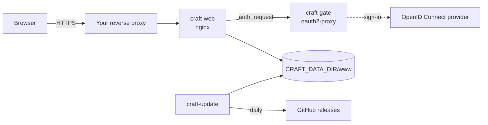

# How it works

## The three containers

| Container | Image | Job |
|---|---|---|
| `craft-web` | `nginxinc/nginx-unprivileged:1.30-alpine-slim` | The only published port. Serves the start page and the apps from `CRAFT_DATA_DIR/www` (the data folder is mounted read-only) and sets the security and cache headers on every response. Asks `craft-gate` about each request first. |
| `craft-gate` | `quay.io/oauth2-proxy/oauth2-proxy:v7.15.5-alpine` | Holds the sign-in. Answers nginx's checks (`/oauth2/auth`: 202 signed in, 401 not), sends people without a session to the OpenID Connect provider and sets the session cookie after the sign-in. Not reachable from outside. |
| `craft-update` | built from `alpine:3.24` (`craftsuite-webapp-update:1`) | Runs once at start and then daily at `CRAFT_UPDATE_TIME`: fetches, checks and switches app releases, adds the Nextcloud translator, writes the start page. |

All three run with a read-only root file system, without Linux capabilities and with
`no-new-privileges`. The scripts of `craft-web` and `craft-update` are part of `compose.yaml`
itself (`command:`), so the one file is the whole configuration; their readable sources are in
[`src/`](../src) ([development.md](development.md)).



### A request

1. The reverse proxy terminates TLS and passes the request to `craft-web`.
2. nginx makes a sub-request to `craft-gate` at `/oauth2/auth`. With a valid session cookie the
   answer is 202 and nginx serves the file.
3. Without one the answer is 401, and nginx hands the request to oauth2-proxy's
   `/oauth2/sign_in`, which redirects the browser to the provider (there is no intermediate
   "Sign in with …" page). nginx passes the original address along, so after the sign-in the
   browser lands where it wanted to go, query string included.
4. The provider sends the browser back to `https://CRAFT_HOST/oauth2/callback`; oauth2-proxy sets
   the session cookie and redirects to the original address.

Only `/healthz` (for the container health check), `/oauth2/*` (the sign-in itself) and the 404
answers for `/releases/…` and hidden files are served without a session.

## The data folder

```text
CRAFT_DATA_DIR/
  www/                        served by craft-web
    index.html                start page, rewritten after every update run
    pdfcraft -> releases/pdfcraft-0.6.0        one symbolic link per app: the version served
    releases/pdfcraft-0.6.0/  one folder per kept version (current and previous)
    releases/pdfcraft-0.5.0/
    ...
  state/
    status                    OK <time> or ERROR <count> <time> of the last run
    <app>.previous            the version a rollback goes back to
    <app>.blocked             a version that is not taken, nor any lower one
    canary-since              per layer version: the time from which its canary failures count
    canary-failed             the canary failure that holds new releases (see below): the issue,
                              then the layer version and time from canary-since it belongs to
  layer/
    craftsuite-layer-hosting-<version>/        the pinned layer bundle (hosting/, translators/)
```

Everything in it can be rebuilt by the updater; there are no user files. Plan about 1.5 GB: one
set of the eleven apps takes about 576 MB with its compressed copies, the previous version of
each app stays (about 1.2 GB together), and an update unpacks a release under
`www/releases/.tmp-*` first (for LightCraft the 102 MB zip and 203 MB unpacked).

## The update run

For each app in `CRAFT_APPS`:

1. **List the releases.** One request to the GitHub API lists the app's last 30 releases. The
   layer's documentation suggests finding the newest release through the redirect of
   `github.com/<owner>/<app>/releases/latest` instead, to spare the API's limit of 60 requests per
   hour per IP address; the list is used here because it has what the checks below need: the
   publication times and GitHub's checksum (digest) of each file.
2. **Choose a release.** It qualifies when its tag is `vX.Y.Z`, it is neither a draft nor a
   pre-release, it has the assets `<app>-web-<version>.zip` and `SHA256SUMS.txt`, it was published
   at least `CRAFT_MIN_AGE_HOURS` ago, and its version is higher than the installed one and than a
   blocked one. If its files were replaced after publication, the age counts from the last upload.
   With the canary check on, the first canary run after it must have tested and passed it
   (below). The highest qualifying version is taken; the updater never moves to a lower version by
   itself.
3. **Hold back?** While a canary issue is open, after a canary failure, while the canary's runs or
   issues cannot be read, or while the layer bundle cannot be used, no new release is taken (see
   below). The installed version stays.
4. **Download and verify.** The zip and `SHA256SUMS.txt` come from
   `https://github.com/storytold/<app>/releases/download/v<version>/`. The zip's SHA-256 must
   match its line in `SHA256SUMS.txt` **and** the digest GitHub reports for the asset. Every entry
   must lie inside `<app>-web-<version>/`, without links and without `..`; after unpacking there
   must be nothing but files and folders, an `index.html` and at least one `.wasm`.
5. **Prepare.** The upstream hosting notes (`README.md`, `HOSTING.md`, `_headers`, `.htaccess`)
   are removed (`craft-web` sets its own headers). If the release has the leftovers of a Cargo
   build at its root (`.fingerprint/` or `.cargo-lock`; LightCraft's has `build/`, `deps/` and
   more), `build/`, `deps/`, `examples/`, `incremental/`, `.fingerprint/` and `.cargo-*lock` are
   removed: the page never loads them. Brotli copies (`*.br`) go too; nginx serves only the `.gz`
   copies. The app icon is fetched from the app's repository at the same tag for the start page
   (cosmetic: without it the start page shows a letter tile). Apart from this, the translator and
   the service worker (step 6), the release is served unchanged; its licence and notice files
   stay.
6. **Add the translator** (Nextcloud integration on): `inject-translator.sh` of the pinned layer
   adds two `<script>` tags after `<head>` and copies the translator files into
   `craftsuite-layer/`. For an app in `CRAFTSUITE_STARTUP_TIMEOUTS` (by default LightCraft and
   EffectCraft, 180000 ms each) the updater passes `--startup-timeout` on every call, and the
   translator waits that long for the app to start instead of 60 s: these apps load their large
   `.wasm` while that timer runs, and 60 s is too short below about 3 Mbit/s (LightCraft) and 2.4
   Mbit/s (EffectCraft) ([configuration.md](configuration.md#nextcloud-integration)). Layer 0.1.0 has no such option
   and gets none. The script of layer 0.2.0 and later also replaces a service worker at the
   build's root, `sw.js` (EffectCraft's), with one that serves nothing, deletes the app's caches
   and unregisters itself; the original stays as `craftsuite-layer/sw.js.orig`. With the apps and
   Nextcloud on the same site, a worker registered by a direct visit would also control the apps
   in the Nextcloud frame and answer with an old `index.html` and translator. Exit code 0: go
   on. Exit code 6 (the layer has no adapter for this app): go on without the translator. Any
   other code: **stop**; the release is not switched to and the installed version keeps running.
7. **Compress** `.html`, `.js`, `.mjs`, `.wasm` and `.otf` with `gzip -9` into `.gz` copies,
   which nginx serves directly (`gzip_static`). This comes after the translator, so the copies of
   `index.html` and of EffectCraft's `sw.js` hold the changed files; copies a release ships itself
   (LightCraft's) are overwritten.
8. **Switch** by replacing the symbolic link `www/<app>` in one atomic rename. Browsers get the new
   version on their next page load. The previous version is kept; older ones are deleted.
9. **Keep the served version current.** After that, the translator of the version being served is
   checked (`inject-translator.sh --check`, with the app's startup timeout) and updated in place if
   the layer version, `CRAFTSUITE_ALLOWED_ORIGINS` or the app's startup timeout changed, or if
   `sw.js` is the app's own again. This is how a new layer release reaches the apps without a new
   app release.

Afterwards the run writes `state/status` and the start page. Any error makes the status
`ERROR <count>`: the start page shows a red notice, `craft-update` turns unhealthy, the apps keep
running in their previous version, and the updater tries again an hour later (up to three times,
then at the next daily time). A run takes one API request per app and two for the canary, its runs
and its issues (only with the Nextcloud integration and the canary check on): thirteen with the
eleven apps. Machines behind the same public IP address share the limit of 60 per hour.

### The layer bundle

With `CRAFTSUITE_LAYER_VERSION` set, the updater downloads
`craftsuite-layer-hosting-<version>.tar.gz` and `SHA256SUMS` from the layer's release, checks
that the bundle's SHA-256 equals both `CRAFTSUITE_LAYER_SHA256` and its line in `SHA256SUMS`,
checks the archive's layout, and unpacks it to `layer/`. It does this again whenever the version,
the checksum or `CRAFTSUITE_LAYER_REPO` changes. The pinned checksum in your configuration means a
changed bundle on GitHub is refused, not used. Changing the version in `.env` is the only way to
move to another layer release; the old bundle is then removed.

### The canary

The layer's repository has a canary, the workflow `canary.yml`, which runs daily on a schedule and
when started by hand. A run fetches the newest release of each app, tests the translators of the
layer's main branch against it, and opens an issue labelled `canary` when that fails (a failing
run while it is open comments on it; the next passing run closes it). With the Nextcloud
integration on and `CRAFTSUITE_CANARY=on`, every update run reads the canary's finished runs on
`main` and its `canary` issues. Only runs that ended with `success` or `failure` count; a
cancelled one (a timeout, for example) tested nothing.

A run starts, for the updater, at its creation (`created_at`), not at `run_started_at`: a re-run
resets that time, and a re-run of failed jobs keeps the canary job's earlier result. A run opens
or closes its issue in its last job, just before it ends, so the updater looks at the issues at
the run's check time: a minute after its end, or at the next counted run's start if that comes
sooner, but never before the end. The run passed if no `canary` issue was open then; a re-run
passed only if none was open at any time from its creation to its check time (an earlier attempt
may have failed). The updater follows three rules:

1. **While a `canary` issue is open, no new release is taken.** For an issue from before your
   layer version came into use (or before a confirmation, rule 3), until the first counted run
   since then has ended, this is a normal wait, not an error: the run logs it, and only an app
   that is not installed yet counts as an error. Any other open issue is a failure (rule 3).
2. **A release is taken only if the first canary run after it tested and passed it.** That run
   is the first counted run that started after the release was published (after its last upload,
   if its files were replaced). The release must still have been the newest release of its app
   when that run ended, so that the run tested it and not a newer one, and the run must have
   passed. A release that was replaced by a newer one before that is never taken; the newer one
   is. Neither is a release whose first run did not pass, even if later runs pass, and also not
   after another layer version, a confirmation or a rebuilt data folder: later runs test the
   layer's main branch, not the pinned layer release. The app's next release that passes its own
   first run is taken.
3. **A failure holds new releases until you act.** A failure is a `canary` issue opened after the
   current `CRAFTSUITE_LAYER_VERSION` came into use (recorded in `state/canary-since`), or one open
   at the check time of the first counted run that started since then, for a re-run at any time
   during it (a failing run comments on the open issue instead of opening a new one). It holds
   every new release of every app, also after the issue is closed: the canary tests the layer's
   main branch, so a passing run after a fix there does not show that the pinned layer release
   handles the new app releases. Once found, a failure is kept in `state/canary-failed`, and it
   keeps holding when its run is re-run or drops out of the last 100 runs. The hold counts as an
   error, so the start page, the status and the health check show it. It ends when another layer
   version is in use (a bundle that fails its checks does not count; going back to a version keeps
   the time it first came into use, and so its failures), or when you confirm that the failure
   does not concern your layer version by removing `state/canary-since`
   ([operations.md](operations.md#the-canary-hold)); failures count again from that moment.

The hold is global: the updater does not look at which app an issue is about, so a failure of any
app, also of one that is not in `CRAFT_APPS`, holds the new releases of all apps. Only the label
`canary` counts; the layer's issues labelled `canary-ui` or `canary-nextcloud` hold nothing, and a
run that failed only in the layer's look at the next Nextcloud release opens no `canary` issue
and counts as passed.

Each run logs when the newest counted run started and how it ended, as in
`layer: newest canary run started <time> (success)`. After `success` or `failure` come `, re-run`
for a re-run, then `, canary issue open` if the run did not pass, or `, no canary issue` if it
failed but counts as passed. GitHub starts scheduled runs late, skips some, and turns a schedule
off after 60 days without activity in a public repository. So when that run started more than
three days ago, or there is none, the run reports an error instead
(`layer: ERROR - the newest canary run of … started …, more than three days ago: …`, or
`… has no finished run: …`), which the status, the start page and the health check show. It
holds nothing: releases that an earlier run tested are still taken, and those that came out since
wait for a run; without any run, no new release is taken. The error cannot be acknowledged: it
ends only with a new counted run (a re-run of an older one keeps that run's start), or with the
canary check off (`CRAFTSUITE_CANARY=off`, or the Nextcloud integration off).

Limits: only the last 100 finished runs are looked at (about three months of daily runs); for a
release older than all of them, the oldest of them that counts stands in for its first run, so a
release that stayed its app's newest for that long is judged by that run, even if its own first
run failed. A run
that failed without a `canary` issue counts as passed, as one where only the look at the next
Nextcloud release failed. Rarely, though, its canary job was cancelled while that look failed, or
its report job failed after a canary failure; the run's data cannot show this. The minimum age
(`CRAFT_MIN_AGE_HOURS`) gives the next run time to report such a failure before the release is
taken only if that run ends within it: the age counts from the release, and the next daily run
comes about a day after the first, so the default of 24 hours does not reliably cover it; two to
three days leave room for a late next run. No GitHub token is sent, although the layer's
documentation suggests one where the 60 requests per hour are shared: when other machines behind
your public IP address use them up, the run fails and tries again an hour later.

The canary decides with Chromium only: the layer runs the apps' WebKit tests without letting them
decide and runs no app in Firefox, so a release that breaks the translator only in Safari (also on
the iPad) or Firefox opens no `canary` issue. A new or rebuilt data folder knows no earlier
failures: failures count from its first run. GitHub keeps no earlier close time when an issue is
reopened, so a reopened canary issue counts as open from its creation to its last close. Watch the
layer's repository ([operations.md](operations.md#staying-informed)).

## Headers

`craft-web` sets these on every response, including oauth2-proxy's redirects and error pages and
nginx's own error pages:

| Header | Value | Why |
|---|---|---|
| `Content-Security-Policy` | `frame-ancestors <CRAFTSUITE_ALLOWED_ORIGINS>`, or `frame-ancestors 'none'` when that is empty | Only your Nextcloud may frame the apps and the sign-in pages; no other site may (with an empty list: nobody). |
| `X-Content-Type-Options` | `nosniff` | As the upstream builds ask for. |
| `Cache-Control` | `private, max-age=31536000, immutable` for successful answers (200, 206, 304) for `.js`, `.mjs` and `.wasm` files whose names carry Trunk's content hash (a `-` and 8 to 16 hex digits, as in `wordcraft-web-d288edabbaf506a2.js` and `wordcraft-web-d288edabbaf506a2_bg.wasm`); `no-cache` for everything else, including error answers, `index.html`, the translator files in `craftsuite-layer/` and the files that keep their name from one release to the next (such as FilmCraft's, LightCraft's and EffectCraft's `.js` and `.wasm`, and EffectCraft's `sw.js`); oauth2-proxy's own value under `/oauth2/` | New releases and translator updates take effect on the next load; the address `/<app>/` stays the same across releases, so a file without a hash in its name is checked on every load instead of being kept for a year next to a new `index.html`; no shared cache keeps anything; an error is never cached. |

`X-Frame-Options` is never sent: it cannot allow another origin and would block Nextcloud. No
`Cross-Origin-Opener-Policy` or `-Embedder-Policy` either; the apps do not need them. `.wasm` is
served as `application/wasm`, so browsers compile it while downloading. `.otf` is served as
`font/otf` (LightCraft's font) and `.webmanifest` as `application/manifest+json` (EffectCraft's),
both compressed; HTML, plain text and JavaScript are sent with `; charset=utf-8`.

## Security model

- **No user files on the server.** The apps open and save files in the browser. With the
  Nextcloud integration, the file travels from the Nextcloud page to the framed app with
  `postMessage` and back the same way; Nextcloud stores it over WebDAV as the signed-in user. The
  server of the apps only ever sends static files.
- **The sign-in is the access control.** Who can sign in at your provider (for Nextcloud: the
  group the client is limited to) can use the apps; everybody else gets nothing but redirects to
  the provider. The session cookie is `__Host-craft`: host-only, `Secure`, `HttpOnly`,
  `SameSite=Lax`. A session lasts `CRAFT_SESSION_LIFETIME` from the sign-in; it is not checked
  against the provider again in that time, so signing out of the provider or leaving the group
  takes effect when it ends. To end all sessions at once, change `CRAFT_COOKIE_SECRET`.
- **What you trust.** The upstream releases, checked against two checksums from their own GitHub
  release (this protects against corrupted or partial downloads and swapped assets, not against a
  compromised upstream account), and the layer bundle, pinned by a checksum you put in `.env`.
  The minimum age gives the projects time to withdraw a bad release.
- **Framing.** Only the origins in `CRAFTSUITE_ALLOWED_ORIGINS` may frame anything on this host.
  The translator itself talks only to those origins (its own copy of the same list in
  `data-allowed-origins`) and stays inactive when the app is opened directly.
- **Containers.** Read-only, no capabilities, unprivileged users (`nginx` 101, `nobody` for
  oauth2-proxy, `CRAFT_USER` for the updater), memory limits. Only `craft-web` has a published
  port. The updater has write access to `CRAFT_DATA_DIR` only. `craft-web` finds `craft-gate`
  through Docker's internal DNS; its `ndots:1` option keeps that name from being looked up in your
  network's DNS while `craft-gate` is restarting, so no other machine can answer in its place.
- **The host name.** Never serve the apps under your Nextcloud's host name: code there could use
  the Nextcloud session. A separate host under the same registrable domain
  (`craft.example.com` next to `cloud.example.com`) is right; see
  [nextcloud.md](nextcloud.md#the-sign-in-cookie-and-the-frame).
