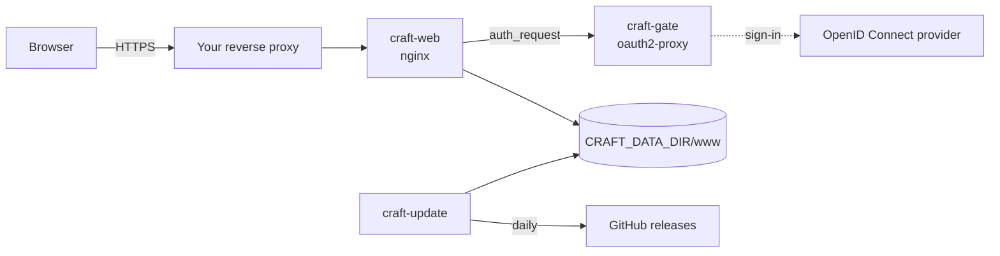

# How it works

## The three containers

| Container | Image | Job |
|---|---|---|
| `craft-web` | `nginxinc/nginx-unprivileged:1.30-alpine-slim` | The only published port. Serves the start page and the apps from `CRAFT_DATA_DIR/www` (the data folder is mounted read-only) and sets the security and cache headers on every response. Asks `craft-gate` about each request first. |
| `craft-gate` | `quay.io/oauth2-proxy/oauth2-proxy:v7.15.5-alpine` | Holds the sign-in. Answers nginx's checks (`/oauth2/auth`: 202 signed in, 401 not), sends people without a session to the OpenID Connect provider and sets the session cookie after the sign-in. Not reachable from outside. |
| `craft-update` | built from `alpine:3.24` (`craftsuite-webapp-update:1`) | Runs once at start and then daily at `CRAFT_UPDATE_TIME`: fetches, checks and switches app releases, adds the Nextcloud translator, writes the start page. |

All three run with a read-only root file system, without Linux capabilities and with
`no-new-privileges`. The scripts of `craft-web` and `craft-update` are part of `compose.yaml`
itself (`command:`), so the one file is the whole configuration; their readable sources are in
[`src/`](../src) ([development.md](development.md)).



### A request

1. The reverse proxy terminates TLS and passes the request to `craft-web`.
2. nginx makes a sub-request to `craft-gate` at `/oauth2/auth`. With a valid session cookie the
   answer is 202 and nginx serves the file.
3. Without one the answer is 401, and nginx hands the request to oauth2-proxy's
   `/oauth2/sign_in`, which redirects the browser to the provider (there is no intermediate
   "Sign in with …" page). nginx passes the original address along, so after the sign-in the
   browser lands where it wanted to go, query string included.
4. The provider sends the browser back to `https://CRAFT_HOST/oauth2/callback`; oauth2-proxy sets
   the session cookie and redirects to the original address.

Only `/healthz` (for the container health check), `/oauth2/*` (the sign-in itself) and the 404
answers for `/releases/…` and hidden files are served without a session.

## The data folder

```text
CRAFT_DATA_DIR/
  www/                        served by craft-web
    index.html                start page, rewritten after every update run
    pdfcraft -> releases/pdfcraft-0.8.0        one symbolic link per app: the version served
    releases/pdfcraft-0.8.0/  one folder per kept version (current and previous)
    releases/pdfcraft-0.7.1/
    ...
  state/
    status                    OK <time> or ERROR <count> <time> of the last run
    <app>.previous            the version a rollback goes back to
    <app>.blocked             a version that is not taken, nor any lower one
    canary-since              per layer version: the time from which its canary failures count
    canary-failed             the canary failure that holds new releases (see below): the issue
                              or run, then the layer version and time from canary-since it
                              belongs to, then the apps it holds ("*" for all)
    canary-layers             per commit the canary ran on: the layer version it tested
    canary-reports            the canary's reports seen so far, for the runs still listed
    app-list                  the last app list of the layer that could be read (for the start page)
  layer/
    craftsuite-layer-hosting-<version>/        the pinned layer bundle (apps.json, hosting/,
                                               translators/)
```

Everything in it can be rebuilt by the updater; there are no user files. Plan about 1.5 GB: one
set of the twelve apps takes about 580 MB with its compressed copies, the previous version of
each app stays (about 1.2 GB together), and an update unpacks a release under
`www/releases/.tmp-*` first (for LightCraft 0.8.0 the 67 MB zip and 87 MB unpacked).

## The update run

For each app in the list that `CRAFT_APPS` stands for
([configuration.md](configuration.md#the-app-list)):

1. **List the releases.** One request to the GitHub API lists the last 30 releases of the app's
   repository `<repo>`: the one the layer's app list names (`storytold/<app>` for all twelve
   apps), or `storytold/<app>` for an app it does not have. The layer's documentation suggests
   finding the newest release through the redirect of
   `github.com/<owner>/<app>/releases/latest`, to spare the API's limit of 60 requests per hour
   per IP address, and the list for an updater that keeps a minimum age or checks GitHub's
   checksum (digest) of each file, as this one does.
2. **Choose a release.** It qualifies when its tag is `vX.Y.Z`, it is neither a draft nor a
   pre-release, it has the assets `<app>-web-<version>.zip` and `SHA256SUMS.txt`, it was published
   at least `CRAFT_MIN_AGE_HOURS` ago, its version is higher than the installed one and than a
   blocked one, and not below the app list's `minVersion`. If its files were replaced after
   publication, the age counts from the last upload. With the canary check on, the first canary
   run of your layer version after it must have tested it and passed for the app (below). The
   highest qualifying version is taken; the updater never moves to a lower version by itself.
3. **Hold back?** While an open canary issue names the app, after a canary failure for the app,
   while the canary cannot be read, while the app list cannot be read, or while the layer bundle
   cannot be used, no new release is taken (see below). The installed version stays; an app that
   is not installed yet waits.
4. **Download and verify.** The zip and `SHA256SUMS.txt` come from
   `https://github.com/<repo>/releases/download/v<version>/`. The zip's SHA-256 must
   match its line in `SHA256SUMS.txt` **and** the digest GitHub reports for the asset. Every entry
   must lie inside `<app>-web-<version>/`, without links and without `..`; after unpacking there
   must be nothing but files and folders, an `index.html` and at least one `.wasm`.
5. **Prepare.** The upstream hosting notes (`README.md`, `HOSTING.md`, `_headers`, `.htaccess`)
   are removed (`craft-web` sets its own headers). If the release has the leftovers of a Cargo
   build at its root (`.fingerprint/` or `.cargo-lock`; earlier LightCraft releases had `build/`,
   `deps/` and more), `build/`, `deps/`, `examples/`, `incremental/`, `.fingerprint/` and
   `.cargo-*lock` are removed: the page never loads them. Brotli copies (`*.br`) go too; nginx
   serves only the `.gz` copies. The app icon is fetched from the app's repository at the same tag
   for the start page
   (cosmetic: without it the start page shows a letter tile). Apart from this, the translator and
   the service worker (step 6), the release is served unchanged; its licence and notice files
   stay.
6. **Add the translator** (Nextcloud integration on): `inject-translator.sh` of the pinned layer
   adds two `<script>` tags after `<head>` and copies the translator files into
   `craftsuite-layer/`. For an app with a startup timeout (its entry in
   `CRAFTSUITE_STARTUP_TIMEOUTS`, else the app list's `startupTimeout`: 180000 ms for LightCraft
   and EffectCraft) the updater passes `--startup-timeout` on every call, and the translator waits
   that long for the app to start instead of 60 s: these apps load their large `.wasm` while that
   timer runs, and 60 s is too short below about 3 Mbit/s (LightCraft) and 2.4 Mbit/s
   (EffectCraft) ([configuration.md](configuration.md#nextcloud-integration)). Layer 0.1.0 has no
   such option and gets none. The script of layer 0.2.0 and later also replaces a service worker
   at the build's root, `sw.js` (EffectCraft's), with one that serves nothing, deletes the app's
   caches and unregisters itself; the original stays as `craftsuite-layer/sw.js.orig`. With the
   apps and Nextcloud on the same site, a worker registered by a direct visit would also control
   the apps in the Nextcloud frame and answer with an old `index.html` and translator. Exit code
   0: go on. Exit code 6 (the layer has no adapter for this app): go on without the translator. Any
   other code: **stop**; the release is not switched to and the installed version keeps running.
7. **Compress** `.html`, `.js`, `.mjs`, `.wasm` and `.otf` with `gzip -9` into `.gz` copies,
   which nginx serves directly (`gzip_static`). This comes after the translator, so the copies of
   `index.html` and of EffectCraft's `sw.js` hold the changed files; copies a release ships itself
   (LightCraft's) are overwritten.
8. **Switch** by replacing the symbolic link `www/<app>` in one atomic rename. Browsers get the new
   version on their next page load. The previous version is kept; older ones are deleted.
9. **Keep the served version current.** After that, the translator of the version being served is
   checked (`inject-translator.sh --check`, with the app's startup timeout) and updated in place if
   the layer version, `CRAFTSUITE_ALLOWED_ORIGINS` or the app's startup timeout changed, or if
   `sw.js` is the app's own again. This is how a new layer release reaches the apps without a new
   app release. A served version below the app list's `minVersion` gets no translator: it is
   removed, since the layer's adapter does not handle that version, and every run reports an error
   until a newer release is taken.

Apps that are served but not in the list are left out of these steps and off the start page; the
translator of one that the layer's app list no longer has is removed
([configuration.md](configuration.md#the-app-list)).

Afterwards the run writes `state/status` and the start page. Any error makes the status
`ERROR <count>`: the start page shows a red notice, `craft-update` turns unhealthy, the apps keep
running in their previous version, and the updater tries again an hour later (up to three times,
then at the next daily time).

A run takes one API request per app and, with the Nextcloud integration and the canary check on,
up to three for the canary: its runs, its issues and, while one of the listed runs failed or is a
re-run (and a `canary` issue exists), the comments on its issues. That is fifteen with the twelve
apps, fourteen without the comments. For each commit the canary ran on that the updater has not
seen yet, it also downloads `translators/core.js` from `raw.githubusercontent.com`, which is not
an API request. Machines behind the same public IP address share the API's limit of 60 per hour.

### The layer bundle

With `CRAFTSUITE_LAYER_VERSION` set, the updater downloads
`craftsuite-layer-hosting-<version>.tar.gz` and `SHA256SUMS` from the layer's release, checks
that the bundle's SHA-256 equals both `CRAFTSUITE_LAYER_SHA256` and its line in `SHA256SUMS`,
checks the archive's layout, and unpacks it to `layer/`. It does this again whenever the version,
the checksum or `CRAFTSUITE_LAYER_REPO` changes. The pinned checksum in your configuration means a
changed bundle on GitHub is refused, not used. With a pinned version, changing it in `.env` is
the only way to move to another layer release; the old bundle is then removed.

With `CRAFTSUITE_LAYER_VERSION=auto` (from 0.5.0 on) the updater follows the layer's releases
itself. The layer in use is the verified bundle in `layer/`. Each run (not `--status` or
`--rollback`) reads the layer's newest releases (one API request) and moves to the highest one
that is not a draft or a prerelease and has a hosting bundle and `SHA256SUMS`, when it is higher
than the one in use and:

- GitHub has a SHA-256 of its hosting bundle (the asset's `digest`); the download must match it
  and its line in `SHA256SUMS`, as a pinned checksum would.
- With the canary on, its newest finished canary run (the runs of its layer version, read from
  `translators/core.js` at each run's commit, as for the canary below) did not fail for every app.
  A run that failed for single apps tested the translators and found those apps' new releases at
  fault: rules 2 and 3 below judge them. Until such a run has ended, the release waits, without an
  error (`layer: <version> is out, it waits for a finished canary run of it; …`).
- Its translator speaks the protocol of the layer in use (`PROTOCOL_VERSION` in `core.js`). The
  Nextcloud app speaks it too, and within one protocol version translator and Nextcloud app of
  different layer releases work together (the layer's
  [protocol.md](https://github.com/hozwei/nextcloud-craftsuite-layer/blob/v0.5.2/docs/protocol.md),
  version 1 since layer 0.1.0). A release with another protocol version is an error of every run
  until you move to it by hand, together with the Nextcloud app
  ([operations.md](operations.md#upgrading-nextcloud-craftsuite-layer)).

It never goes back to a lower release. A release that fails its download or one of its checks
leaves the layer in use as it is, with an error. Moving works as with a changed pinned version:
the translators in the versions being served are updated, the canary counts the new layer
version's runs from then on, and the old bundle is removed. Without a bundle in `layer/` (a first
installation) and without a release that qualifies, no app is installed, with an error, until one
does.

From layer 0.5.0 on, the bundle carries the app list, `apps.json`: the apps the layer release
supports and, for each, its name, repository, short texts, colour, recommended startup timeout
and the oldest release its adapter handles
([the layer's hosting.md](https://github.com/hozwei/nextcloud-craftsuite-layer/blob/v0.5.2/docs/hosting.md#the-app-list)).
The updater reads format 1 and checks every value before it uses it: an app with an invalid id,
repository or `minVersion` is left out, with an error; an invalid name, text, colour or timeout is
not used. A list that is not JSON or has another format is an error, and no new release is taken
while it lasts (`app list not readable`). `--status` reads the list from the bundle in the data
folder, without a network request. What the updater takes from it:
[configuration.md](configuration.md#the-app-list).

### The canary

The layer's repository has a canary, the workflow `canary.yml`, which runs daily on a schedule and
when started by hand. A run fetches the newest release of each app and tests the translators on
the layer's main branch against it. When that fails, it opens an issue labelled `canary` (a
failing run while one is open comments on it; the next passing run comments and closes it). From
layer 0.5.0 on, it also gives the issue a label `canary:<app>` for each app whose tests failed,
and ends every report (the issue's text, each comment) with a line `` `canary-result {...}` ``
that names the run, its attempt, the apps that failed and the app versions it tested
([the layer's hosting.md](https://github.com/hozwei/nextcloud-craftsuite-layer/blob/v0.5.2/docs/hosting.md#updates),
step 4). With the Nextcloud integration on and `CRAFTSUITE_CANARY=on`, every update run reads the
canary's last 100 runs on `main`, its issues labelled `canary` and the reports in them, and judges
each app on its own: a failure holds back only the apps it names.

**Which runs count.** Only runs of your layer version. A run tested the translators at its
commit; the updater reads their version, `LAYER_VERSION` in `translators/core.js` at that commit,
from `raw.githubusercontent.com`, once per commit (`state/canary-layers` keeps it). The time of a
run is no guide: the layer puts its release commit on `main` before the tag, and the canary
often runs on it before the release is out, already testing the new translators. Runs of older
and newer layer versions tested other translators. Of the runs of your layer version, those that
ended with `success` or `failure` are judged, and re-runs that ended otherwise (`cancelled`,
`timed_out`, …), and first attempts that ended so with a report of their own; any other first
attempt (cancelled after a timeout, for example) tested nothing. A run that is
queued or running, also a re-run of an older run, is pending: the releases it is the first run
for wait until it has ended.

A run starts, for the updater, at its creation (`created_at`), not at `run_started_at`: a re-run
resets that time, and a re-run of failed jobs keeps the earlier result of the jobs that passed. A
run changes its issue in its last job, just before it ends, so the updater looks at the issues at
the run's check time: a minute after its end, or at the start of the next run that ended with
`success` or `failure` if that comes sooner, but never before its end (for a cancelled re-run, at
its end).

**The apps a run failed for.** Only reports written by the workflow count
(`github-actions[bot]`): anybody may comment on a public issue. Each report seen is kept in
`state/canary-reports` while its run is listed, so that a later page of comments cannot lose it.

- A **failed** run failed for the apps its reports name, if its last attempt has a report of its
  own; without one, or when they name no app, for every app.
- A **passed** run failed for the apps that the reports of its earlier attempts name: a re-run of
  failed jobs can pass after a failure. Without any report, it failed for every app if a `canary`
  issue was open at its check time (for a re-run, at any time since its creation).
- A **re-run that ended otherwise** (or such a first attempt) failed for the apps that the
  reports of its attempts name, else for every app.
- A **re-run** during which a `canary` issue was open, and of whose earlier attempts one has no
  report, failed for every app: that attempt may have failed for any of them.

The updater follows three rules:

1. **An open `canary` issue holds the apps it names**: the apps its newest report names (the
   report of the highest run, then of its highest attempt) and its `canary:<app>` labels, which
   the workflow keeps to the apps of its latest failing run. An app that only an older report in
   the issue names is not held by it: a later run passed it, and rules 2 and 3 judge the runs of
   your layer version for it. So a release that an old report named comes with a layer release
   that handles it, even while the issue stays open for another app (0.4.0 and 0.4.1 held every
   app that any report in the issue named). An open issue with neither (one opened before layer
   0.5.0, say) holds every app. This applies to every open issue, whichever layer version its runs
   tested, and it is a wait, not an error: the run logs
   `layer: the canary reports a failure for <apps> (<issue>), their new releases wait while the issue is open`.
2. **A release is taken only if the first run of your layer version after it tested it and passed
   for its app.** That run is the first run of your layer version created after the release was
   published (after its last upload, if its files were replaced). It tested the release if it has
   ended, no later release of the app came out before its end, the release was the app's highest
   version out by then, and the run's own report, where it has one with the versions it tested,
   names this version. A release whose first run did not test it, or failed for its app, is not
   taken with this layer version, even if later runs pass (the layer's documentation advises the
   same: a later green run does not make up for a failed one); the app's next release that passes
   its own first run is. After you move to another layer version, the first run of that version
   after the release decides: a release that the old version's first run failed for comes by itself
   if the new version's first run after it passed for it and it was still its app's newest release
   then. When the list of the last 100 runs is full and holds no run of an older layer version, a
   release older than all of them has no known first run and is not taken. For a release that
   waits, every run names the reason (`stays, no newer release qualifies yet (<version>: <reason>)`).
3. **A failure holds the apps' new releases until you act.** A failure is a run of your layer
   version, created after that version came into use (recorded in `state/canary-since`), that
   failed for one or more apps (above). It holds the new releases of those apps, also after its
   issue is closed and later runs passed; the other apps are updated as usual. Once found, it is
   kept in `state/canary-failed` (the issue or run, the layer version and time it belongs to, the
   apps), and it keeps holding when its run is re-run or drops out of the last 100 runs. A
   `state/canary-failed` left by craftsuite-webapp 0.3.0, without the line of apps, holds every
   app while its layer version and time are the ones in use. The hold counts as an error, so the
   status, the health check and the start page show it; the start page and `--status` name the
   apps. A failure only of apps that are not served here holds nothing and is a log line, not an
   error. It ends when another layer version is in use (a bundle that fails its checks does not
   count; going back to a version keeps the time it first came into use, and so the failures of
   its runs since then that are still listed), or when you confirm that the failure does not
   concern your layer version by removing `state/canary-since`
   ([operations.md](operations.md#the-canary-hold)); failures count again from that moment.

An app that is not installed yet waits under any of these rules, with the line
`<app>: not installed yet, <version> waits (<reason>)` and no error of its own. An app named in
`CRAFT_APPS` that the app list of your layer version does not have is not tested by its canary:
only the minimum age applies (`<app>: not in the app list of layer <version>, which does not test
it: its releases are taken by age alone`). Only the label
`canary` counts; the layer's issues labelled `canary-ui` or `canary-nextcloud` hold nothing, and
its look at the next Nextcloud release never fails a run.

Each run logs the newest finished run of your layer version, as in
`layer: newest canary run of layer 0.5.1 started 2026-10-17 17:01:41 (success)`. After its
conclusion (`success`, `failure`, or `cancelled` for a re-run) come `, re-run` for a re-run and
`, failed for <apps>` or `, failed for every app` when it failed for apps, for example
`(success, re-run, failed for wordcraft)`. GitHub starts scheduled runs late, skips some, and
turns a schedule off after 60 days without activity in a public repository; and once a newer layer
release is out, the canary tests that one. So the run reports an error instead:

- when the newest run of your layer version started more than three days ago
  (`layer: ERROR - the newest canary run of layer <version> started <time>, more than three days ago: …`);
  when runs of a newer layer version exist, the error says so
  (`…; runs since then test a newer layer version (the newest: <newer>): new releases wait until a newer one is in use …`);
- when no finished run of your layer version is listed, three days after that version came into use
  (`layer: ERROR - no canary run has tested layer <version> since it came into use <time>, more than three days ago…`);
  until then, the run only logs
  `layer: no canary run has tested layer <version> yet; new releases wait for one`;
- when the canary has no judged run at all, of any layer version
  (`layer: ERROR - the canary of <repo> has no finished run: …`).

While runs of a newer layer version exist, every run also logs
`layer: canary runs since <time> test a newer layer version than <version> (the newest: <newer>): releases that came out since wait until a newer layer version is in use …`:
time to [upgrade the layer](operations.md#upgrading-nextcloud-craftsuite-layer). The errors show
in the status, the start page and the health check, and hold nothing themselves: releases that an
earlier run of your layer version tested are still taken, and those that came out since wait for
one. They cannot be acknowledged: they end with a new run of your layer version (a re-run of an
older one keeps that run's start), with another layer version in use, or with the canary check off
(`CRAFTSUITE_CANARY=off`, or the Nextcloud integration off).

Limits: only the last 100 runs are looked at (about three months of daily runs, less with runs
started by hand); when the list is full, a release older than all of them is not taken, also on a
new data folder (take it with `-e CRAFTSUITE_CANARY=off`, [operations.md](operations.md#update-now)).
The reports come from the issues' texts and from one page of the newest 100 comments on the
layer's issues since the oldest listed run that failed or was re-run; when more comments came
since, older reports may not be on it, and a failed run whose report is neither there nor in
`state/canary-reports` counts as failed for every app. A passed run that closed no issue writes
no report, so which versions it tested is not known: it counts as having tested a release that no
later one followed before its end and that was its app's highest version by then. No GitHub token
is sent, although the layer's documentation suggests one where the 60 requests per hour are
shared: when other machines behind your public IP address use them up, the run fails and tries
again an hour later.

The canary decides with Chromium only: the layer runs the apps' WebKit tests without letting them
decide and runs no app in Firefox, so a release that breaks the translator only in Safari (also on
the iPad) or Firefox fails no run. A new or rebuilt data folder knows no earlier failures:
failures count from its first run. GitHub keeps no earlier close time when an issue is reopened,
so a reopened canary issue counts as open from its creation to its last close. Watch the layer's
repository ([operations.md](operations.md#staying-informed)).

## Headers

`craft-web` sets these on every response, including oauth2-proxy's redirects and error pages and
nginx's own error pages:

| Header | Value | Why |
|---|---|---|
| `Content-Security-Policy` | `frame-ancestors <CRAFTSUITE_ALLOWED_ORIGINS>`, or `frame-ancestors 'none'` when that is empty | Only your Nextcloud may frame the apps and the sign-in pages; no other site may (with an empty list: nobody). |
| `X-Content-Type-Options` | `nosniff` | As the upstream builds ask for. |
| `Cache-Control` | `private, max-age=31536000, immutable` for successful answers (200, 206, 304) for `.js`, `.mjs` and `.wasm` files whose names carry Trunk's content hash (a `-` and 8 to 16 hex digits, as in `wordcraft-web-d288edabbaf506a2.js` and `wordcraft-web-d288edabbaf506a2_bg.wasm`); `no-cache` for everything else, including error answers, `index.html`, the translator files in `craftsuite-layer/` and the files that keep their name from one release to the next (such as FilmCraft's, LightCraft's and EffectCraft's `.js` and `.wasm`, and EffectCraft's `sw.js`); oauth2-proxy's own value under `/oauth2/` | New releases and translator updates take effect on the next load; the address `/<app>/` stays the same across releases, so a file without a hash in its name is checked on every load instead of being kept for a year next to a new `index.html`; no shared cache keeps anything; an error is never cached. |

`X-Frame-Options` is never sent: it cannot allow another origin and would block Nextcloud. No
`Cross-Origin-Opener-Policy` or `-Embedder-Policy` either; the apps do not need them. `.wasm` is
served as `application/wasm`, so browsers compile it while downloading. `.otf` is served as
`font/otf` (LightCraft's font) and `.webmanifest` as `application/manifest+json` (EffectCraft's),
both compressed; HTML, plain text and JavaScript are sent with `; charset=utf-8`.

## Security model

- **No user files on the server.** The apps open and save files in the browser. With the
  Nextcloud integration, the file travels from the Nextcloud page to the framed app with
  `postMessage` and back the same way; Nextcloud stores it over WebDAV as the signed-in user. The
  server of the apps only ever sends static files.
- **The sign-in is the access control.** Who can sign in at your provider (for Nextcloud: the
  group the client is limited to) can use the apps; everybody else gets nothing but redirects to
  the provider. The session cookie is `__Host-craft`: host-only, `Secure`, `HttpOnly`,
  `SameSite=Lax`. A session lasts `CRAFT_SESSION_LIFETIME` from the sign-in; it is not checked
  against the provider again in that time, so signing out of the provider or leaving the group
  takes effect when it ends. To end all sessions at once, change `CRAFT_COOKIE_SECRET`.
- **What you trust.** The upstream releases, checked against two checksums from their own GitHub
  release (this protects against corrupted or partial downloads and swapped assets, not against a
  compromised upstream account), and the layer bundle, pinned by a checksum you put in `.env`.
  The minimum age gives the projects time to withdraw a bad release.
- **Framing.** Only the origins in `CRAFTSUITE_ALLOWED_ORIGINS` may frame anything on this host.
  The translator itself talks only to those origins (its own copy of the same list in
  `data-allowed-origins`) and stays inactive when the app is opened directly.
- **Containers.** Read-only, no capabilities, unprivileged users (`nginx` 101, `nobody` for
  oauth2-proxy, `CRAFT_USER` for the updater), memory limits. Only `craft-web` has a published
  port. The updater has write access to `CRAFT_DATA_DIR` only. `craft-web` finds `craft-gate`
  through Docker's internal DNS; its `ndots:1` option keeps that name from being looked up in your
  network's DNS while `craft-gate` is restarting, so no other machine can answer in its place.
- **The host name.** Never serve the apps under your Nextcloud's host name: code there could use
  the Nextcloud session. A separate host under the same registrable domain
  (`craft.example.com` next to `cloud.example.com`) is right; see
  [nextcloud.md](nextcloud.md#the-sign-in-cookie-and-the-frame).
